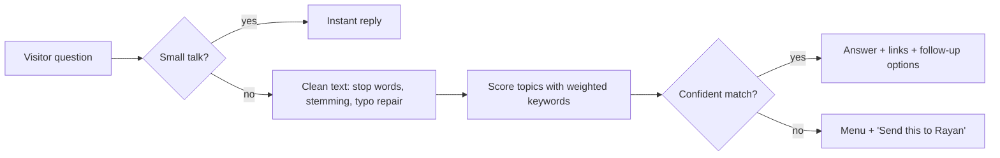

<div align="center">

# Rayan Alam · Portfolio

**A single-page portfolio with a living WebGL background, an offline AI-style assistant, and zero frameworks.**

[](https://rayan-alam-uoit.github.io/)


</div>

<!-- Add a screenshot or short GIF at docs/preview.png and uncomment:
<p align="center"></p>
-->

---

## Why this exists

Most portfolios are a wall of sections. This one is built around a simple rule: **a recruiter should understand who I am in 30 seconds, and be able to ask anything after that.** So it is one calm page (work, projects, interview prep, certifications, GitHub activity, contact) with a few details that reward curiosity.

## What makes it different

| | |
|---|---|
| **Living background** | A hand-written GLSL fragment shader warps layered noise into contour lines that drift slowly and bend toward the cursor. It follows the theme colours, renders at half resolution, caps at ~30 fps, and pauses in background tabs. |
| **An assistant with no backend** | The chat widget answers questions about my work with a custom keyword-scoring engine that runs entirely in the browser. No API key, no server, no cost, no hallucinations. See [How the assistant works](#how-the-assistant-works). |
| **Theme switch with a reveal** | Light/dark changes with a circular wipe from the toggle button (View Transitions API), with a plain fade fallback. |
| **Live GitHub graph** | A contribution heatmap built from the GitHub profile, with a fallback image if the request fails. |
| **A typing "LeetCode editor"** | The interview prep card types out classic solutions and flashes *Accepted*, linking to my real prep repo. |
| **Custom cursor** | A dot plus a trailing ring that grows over links and labels project cards. Mouse-only: it never loads on touch devices. |

## Features

- **Design:** responsive single column, glass cards, light/dark themes driven by CSS variables, staggered entrance animation
- **Contact:** validated form with floating labels, topic chips, character counter, honeypot spam trap, animated send/success states, and a prefilled `mailto:` fallback if sending fails (via [FormSubmit](https://formsubmit.co))
- **Assistant:** 30+ topics, typo tolerance, small talk, "tell me more", clickable follow-ups, and a *Send this to Rayan* button that prefills the contact form
- **Icons & branding:** animated project icons, "RA" monogram favicon (SVG with a light-mode variant, PNG fallbacks), certification tiles with issuer logos
- **Accessibility:** `prefers-reduced-motion` support, visible focus states, labelled controls, `aria-live` chat log, 44px touch targets
- **Mobile:** safe-area insets, 16px inputs (no iOS zoom), chat opens as a bottom sheet, lighter blur for performance
- **Performance:** no framework, no build step, no JavaScript dependencies, and a half-resolution shader

## How the assistant works



Every topic is a plain object in `script.js` (`TOPICS`). Keywords carry weights (`!` strong, none normal, `~` weak, `!!` named entities), so *"Tell me about the SpaceX project"* beats the generic *Projects* answer. Typos are repaired with edit distance against the keyword vocabulary, so *"kubernetis"* still resolves to Kubernetes. Questions it should not guess (salary, visa, phone) are routed to a *Send this to Rayan* action instead.

There is an optional hook (`CHAT_ENDPOINT`) and a sample serverless function in `api/chat.js` for plugging in an LLM later. It is off by default.

## Project structure

```
.
├── index.html        # Content and structure
├── styles.css        # Design tokens, layout, animation (numbered, commented sections)
├── script.js         # Theme, GitHub graph, assistant, contact form, editor demo, shader, cursor
├── images/           # Logos, favicons, photos
├── files/            # Resume and certification PDFs
└── api/chat.js       # Optional LLM endpoint (unused by default)
```

## Run locally

No install needed.

```bash
git clone https://github.com/Rayan-Alam-UOIT/Rayan-Alam-UOIT.github.io.git
cd Rayan-Alam-UOIT.github.io
python3 -m http.server 8000      # or: npx serve
```

Open `http://localhost:8000`. Serve it over HTTP rather than double-clicking the file, because the GitHub graph and fonts make network requests. The contact form is only expected to work on the deployed origin.

## Customize

| To change | Edit |
|---|---|
| Colours, fonts, spacing | `:root` tokens at the top of `styles.css` (changing `--accent` also recolours the shader) |
| Work, projects, certifications | The matching `<section>` in `index.html` |
| What the assistant knows | `TOPICS` in `script.js` (copy an existing entry) |
| Interview-prep snippets | `SNIPPETS` in `script.js` |
| Where the form sends | `FORM_URL` in `script.js` |
| Shader line strength | the `.2` in `gl.uniform1f(uK,.2)` |

## Deploy

- **GitHub Pages:** push to `main`; the site publishes at `https://<username>.github.io/`.
- **Vercel / Netlify:** import the repo, choose *Other* as the framework, leave the build command empty.

## Privacy

No analytics and no cookies. The theme choice is stored in `localStorage`. Third-party requests are limited to Google Fonts, a public GitHub contributions API, certification logos from Wikimedia, and FormSubmit when you send a message.

## Design decisions

| Decision | Reasoning |
|---|---|
| Vanilla HTML/CSS/JS | One page does not need a framework. Plain files load instantly, host free, and stay easy to read. |
| Shader instead of a particle library | A fragment shader gives the contour look in a few dozen lines, with no dependency. |
| Offline assistant instead of an LLM API | It is free, instant, private, and cannot invent facts about me. |
| FormSubmit instead of a backend | A serverless form is enough for a portfolio inbox. |

## License

All rights reserved unless a `LICENSE` file states otherwise.

---

<div align="center">

Built by [Rayan Alam](https://www.linkedin.com/in/rayan-alam/) · Computer Science @ Ontario Tech University

</div>